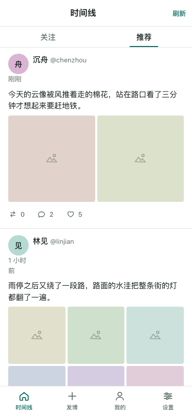
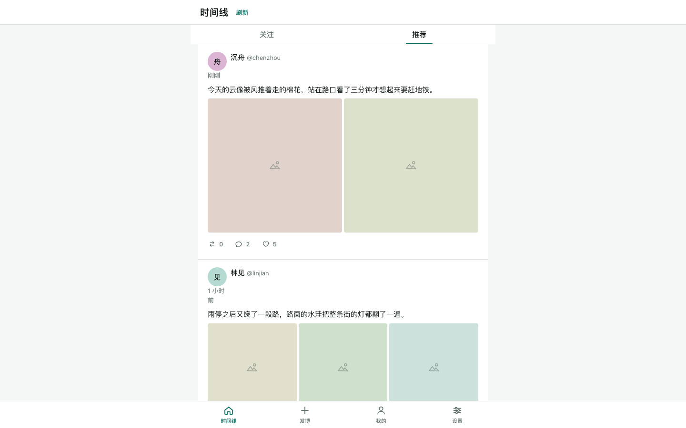
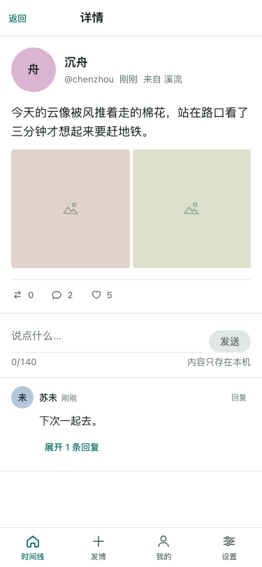

# 溪流（Rill）—— 离线极简信息流客户端

四条主线（时间线 / 详情 / 发博 / 我的）+ 底部 4 项导航 + 亮暗主题，全部离线运行。
运行时依赖只有 `react` / `react-dom` 两项：无 UI 库、无图标库、无路由库、无字体 CDN、无任何二进制资源。

- 应用名：溪流 / Rill（`package.json` 里 `name: rill`、`version: 0.1.0`）
- 状态：四条主线可用 + **49/49 无头验收通过**（逐条证据见 `docs/acceptance.md`）
- 可选在线只读：登录页 `#/login` 粘贴浏览器 Cookie，时间线/详情/用户/搜索走本机 server 的微博只读接口；首次拿到真实 Cookie 后按 [`docs/weibo-verify-15min.md`](docs/weibo-verify-15min.md) 做 15 分钟联调。
- 视觉唯一来源：`docs/design.md`（84 个 `--rill-*` token、7 个自制 inline SVG、§10 参考 CSS）
- 结构/字段/testid 契约：`docs/spec.md`；功能裁剪依据：`docs/capability-inventory.md`

## 预览

| 时间线 375 | 时间线 1440 |
|---|---|
|  |  |

| 发博 375 | 详情 375 |
|---|---|
|  |  |

更多截图（暗色 / 空态 / 错误态 / 关闭态回归图）见 [`docs/shots/`](docs/shots/)。全部为 Chrome 无头 + CDP `Emulation.setDeviceMetricsOverride` 输出的**真 375 / 768 / 1440** 宽图（PNG IHDR 宽 = innerWidth = 目标宽）。

---

## 1. 启动与验证

### 1.1 环境（本机实测）

| 项 | 值 |
| --- | --- |
| Node | `v24.21.0`（DSH 内置运行时；系统另有 `v26.10.0`） |
| pnpm | `v11.28.5`（DSH 内置；**系统 PATH 里没有全局 pnpm**） |
| 缓存 | `~/.npm` 不可写（沙箱 workspace-write），必须指到工作区 |

DSH 内置工具链路径（复制即用）：

```bash
NODE=~/.dsh/dsh-runtimes/dsh-next-primary-runtime/dependencies/node/bin/node
PNPM=pnpm
```

缓存隔离（首次安装前执行一次即可；之后该 shell 内复用）：

```bash
export npm_config_cache=<workspace>/.npm-cache
export npm_config_store_dir=<workspace>/.pnpm-store
export XDG_CACHE_HOME=<workspace>/.cache
```

### 1.2 命令

```bash
# 安装（首次联网；之后可离线：pnpm install --offline --frozen-lockfile）
"$NODE" "$PNPM" install

# 开发模式（http://localhost:5179）
"$NODE" "$PNPM" dev

# 构建（= check:mock → tsc --noEmit → vite build）
"$NODE" "$PNPM" build

# 预览（http://127.0.0.1:4179，双栈监听，localhost / 127.0.0.1 都能连）
"$NODE" "$PNPM" preview

# 单独类型检查 / 重新生成 mock / 校验 mock / 命中测试
"$NODE" "$PNPM" typecheck
"$NODE" "$PNPM" gen:mock
"$NODE" "$PNPM" check:mock
"$NODE" "$PNPM" check:ui      # 坐标点击 + elementFromPoint，需先 build
```

> `pnpm-workspace.yaml` 里的 `allowBuilds: { esbuild: true }` 是必需的：pnpm 11 默认拒绝依赖的构建脚本，不显式允许时 `pnpm install` 会以 `ERR_PNPM_IGNORED_BUILDS` 退出。

### 1.3 无头验收

**静态快照**（路由/探针/聚合属性）用 `--dump-dom`：

```bash
CHROME="/Applications/Google Chrome.app/Contents/MacOS/Google Chrome"
UD=/tmp/rill-verify-ud            # 必须；不给会报 Failed to create a unique user data directory
BASE=http://127.0.0.1:4179
"$CHROME" --headless=new --no-sandbox --disable-gpu --hide-scrollbars \
  --disable-crash-reporter --disable-breakpad --no-first-run \
  --user-data-dir="$UD" --window-size=375,812 --virtual-time-budget=2000 \
  --dump-dom "$BASE/#/timeline" | grep -o 'data-post-count="[0-9]*"'
```

**交互与 375 视口**必须用 CDP（`--window-size=375` 的实际 `innerWidth` 是 500，会假通过）：

```bash
# 起一个可编程的 Chrome
"$CHROME" --headless=new --no-sandbox --disable-gpu --remote-debugging-port=9333 \
  --user-data-dir=/tmp/rill-cdp-ud about:blank
# 然后：Emulation.setDeviceMetricsOverride{width:375,height:812,mobile:true}
#       Runtime.evaluate 里做 click() / 读 getComputedStyle / 读 scrollWidth
```

本轮的脚本在 `/tmp/rill-verify.mjs`（70 项断言）与 `/tmp/rill-measure.mjs`（几何/颜色），截图在 `/tmp/rill-ui/*.png`；它们是临时验证物，**没有进仓库**（仓库不带二进制）。

**命中测试**用 `pnpm check:ui`（`scripts/check-hit.mjs`）：脚本在 BASE 无服务时会自起一个只读 `dist/` 的内置静态服务器（`node:http`，不依赖 `vite preview`，任何 node 都能跑），所有交互都用 CDP `Input.dispatchMouseEvent` 在控件中心按下/抬起，点击前先以 `document.elementFromPoint(cx,cy)` 断言命中的是目标元素或其子节点。覆盖 375 宽 tabbar 四项、compose 发布、768/1440 卡片 like/reply、关闭态 sheet 与旧 reset 坐标。成功时也会逐项打印 `PASS 名称 :: 坐标/命中 tag`，并以 `PASS n / FAIL 0` 收尾；不会出现“安静退出”。Chrome 探测顺序：`CHROME_BIN`/`CHROME`（显式指定优先且不回退）→ `/usr/bin/google-chrome` → `/usr/bin/google-chrome-stable` → `/usr/bin/chromium` → `/usr/bin/chromium-browser` → macOS 的 `/Applications/Google Chrome.app/Contents/MacOS/Google Chrome`；Linux 会带 `--no-sandbox --disable-dev-shm-usage --disable-gpu`。找不到浏览器会打印尝试过的路径并 exit 1；只有显式 `CHECK_UI_SKIP=1` 才跳过（默认必须跑，CI 不设）。单次整体超时默认 120s，可用 `CHECK_UI_TIMEOUT_MS` 调整，失败时日志带 `CHROME_BIN` 与版本。`RILL_BASE` 可改 host:port（内置服务器会跟着绑定同一 host:port），例如 `RILL_BASE=http://127.0.0.1:4318 pnpm check:ui`。

冷启动稳定性：内置服务器先 `await once(server, 'listening')` 再开浏览器；Chrome 默认 `--remote-debugging-port=0` 并从 `DevToolsActivePort` 读实际端口（避免并行跑时抢固定 9337；`RILL_CDP_PORT` 仍可显式覆盖）；`settle` 最长 30s，且以「`readyState=complete` + `#app[data-route]` + `#app[data-post-count]` + tabbar 存在」为业务就绪（不只看外壳）；`goto` 未就绪会自动重试一次，两次都失败才 FAIL，错误里带当前 URL、端口、`readyState`、`#app`、`performance.timing`。

> **不要用 `el.click()` 做交互验收**：它直接派发 DOM 事件、绕过浏览器命中测试。本轮 blocker（关闭态 sheet 覆盖 tabbar / 发布按钮）就是这样漏掉的，随后改用坐标点击立即复现。

注意：
- 同一 `--user-data-dir` 连续 `--dump-dom` 要间隔 ~1s，否则偶发拿到上一页。
- `--dump-dom` 会把 `index.html` 的内联 `<script>` 源码一起输出，数节点会多数；**断言只认 `#app` 上的聚合属性与固定 testid**。
- hash 查询参数写在 `#/…?probe=…` 里，不是 `?probe=…#/…`。

---

## 2. 目录结构

```text
weibo-lite/
├── index.html                 # #root + 首帧防白闪脚本（读 rill:v1:theme，写 data-theme/class）
├── package.json               # dependencies 只有 react / react-dom
├── pnpm-lock.yaml
├── pnpm-workspace.yaml        # allowBuilds: esbuild
├── tsconfig.json              # strict / bundler / react-jsx / noUnused*
├── vite.config.ts             # base './'、双栈预览、modulePreload:false
├── scripts/
│   ├── mock-data.mjs          # 确定性 mock 生成器（固定 LCG，无 Math.random/Date.now）
│   ├── gen-mock.mjs           # 写 src/data/mock.json
│   └── check-mock.mjs         # 分布/引用/不变量校验 + 逐字节比对 + 禁用串扫描
├── docs/
│   ├── capability-inventory.md  # T0 能力盘点（P0/P1/P2）
│   ├── spec.md                  # T1 需求与验收契约（49 AC / 45 IA / 13 探针）
│   └── design.md                # T2 视觉规范（tokens/布局/图标/参考 CSS）
└── src/
    ├── main.tsx               # createRoot + 错误计数 + 7 个 CSS 入口
    ├── App.tsx                # 壳：hash 路由、探针、data-* 聚合属性、tabbar、sheet、toast
    ├── router.ts              # 手写 hash 路由（无路由库）
    ├── probe.ts               # 13 个 boot 探针（仅验收）
    ├── runtime.ts             # window.onerror / unhandledrejection 计数
    ├── storage.ts             # 唯一 localStorage 出入口（rill:v1:*）
    ├── store.ts               # useReducer 单一真源 + 动作 + 选择器 + 持久化
    ├── types.ts               # spec §5.1 的 7 接口 / 41 字段
    ├── components/
    │   ├── icons.tsx          # 7 个自制 inline SVG（home/plus/user/settings/like/reply/repost）
    │   ├── Avatar.tsx         # 无位图头像（hue + 1–2 字）
    │   ├── MediaGrid.tsx      # 图格 + 纯色配图块（带自制几何图标，无文字标签）
    │   ├── PostCard.tsx       # 时间线卡片（compact 变体用于我的页）
    │   ├── ActionBar.tsx      # 转发/回复/赞 计数行（列表与详情共用）
    │   ├── TopicText.tsx      # #话题# chip 化
    │   ├── Segment.tsx        # 段控件（feed-tab / profile-tab）
    │   ├── EmptyState.tsx     # 空态/错误态（同一张自制插图）
    │   ├── Toast.tsx          # 底部 toast（tabbar 之上，pointer-events:none）
    │   ├── Tabbar.tsx         # 4 项底部导航
    │   └── SettingsSheet.tsx  # 原生 <dialog open> + 自绘 scrim
    ├── pages/
    │   ├── Timeline.tsx       # 屏 1
    │   ├── Detail.tsx         # 屏 2（回复 + 楼中楼）
    │   ├── Compose.tsx        # 屏 3
    │   └── Profile.tsx        # 屏 4
    ├── lib/time.ts            # 相对时间（以 mock BASE 为“现在”）
    ├── styles/                # tokens / base / card / detail / compose / profile / feedback
    └── data/
        ├── mock.json          # 12 作者 / 30 动态 / 60 回复
        └── mock.ts            # 类型化入口 + 关注集合 + 安全查询
```

---

## 3. 数据层

### 3.1 mock 规模与确定性（对齐 `docs/spec.md` §5.3）

| 项 | 实现 |
| --- | --- |
| 文件 | `src/data/mock.json`，顶层键 `users / statuses / comments` |
| 规模 | 12 作者 / 30 条动态 / 60 条回复 |
| 作者分布 | `u_01`（当前用户）3 条；`u_02…u_09` 各 1 条（关注流 = 8）；`u_10/u_11/u_12` = 6/6/7 |
| 配图分布 | 0 张 8 / 1 张 5 / 2 张 3 / 3 张 2 / 4 张 5 / 9 张 7（共 30） |
| 转发 / 话题 | `repostOfId != null` 4 条（一层转发）；话题非空 6 条 |
| 长文样本 | `p_0007` 正文 243 字（>140），带 3 处分段、1 个 `#城市散步#`、1 个 `@citywalk`、1 个 `t.cn` 短链；`topics` 与之对应（话题位从 `p_0008` 让过来，总数仍 6） |
| 认证样本 | `verified` 布尔字段：**恰好 2 个 `true`** —— `u_05`（首卡 `p_0001` 作者「沉舟」）、`u_11`（长帖 `p_0007` 作者「摄影笔记」）；其余 10 个 `false`。`u_01` 是当前用户且未认证 |
| 客户端尾巴 | `source` 字符串：每条动态必填、12 种取值（`来自 iPhone 15 Pro` / `来自 iPad Air` / `来自 网页版` / `来自 Mac` / `来自 小米 14` / `来自 Android 客户端` …），**按作者固定同一台设备**，与创作者风格一致 |
| 回复分布 | 29 条动态各有回复，`p_0030` 0 回复（详情空态）；楼中楼 12 条，只一层 |
| 时间 | `BASE = 1794801600000`；动态 `BASE - i*3600000 - (i*7919 % 1800000)`，严格倒序 |
| 回复时间 | `post.createdAt + (k+1)*180000 + (j*7919 % 60000)`（晚于其动态） |
| 新内容时间 | `max(BASE + n*60000, 最新动态 + 60000, 最新回复 + 60000)`——保证新回复永远排第一（AC-DT02） |
| 随机性 | 固定 LCG（`SEED = 0x51ed5e01`）；**没有** `Math.random` / `Date.now` |
| 配图 alt | 纯描述（如「灰蓝色天空」），**不含“占位”字样**；UI 只渲染色块 + 几何图标，不渲染任何文字标签 |
| 可重复 | `gen:mock` 两次逐字节一致；`check:mock` 会把仓库 JSON 与生成器输出比对 |
| 新增字段 | `Author.verified?: boolean`、`Post.source?: string`。mock 里**必有**（`check:mock` 强校验）；在线适配层/我发布的新内容可能缺省 → 读取侧写 `author.verified === true`，`source` 存在才显示、缺失不伪造；`来自 ` 前缀只由呈现层 `displaySource` 补。 |

> `check:mock` 对上面三样都设了不变量：长帖 `text.length >= 140` 且含 `#…#` / `@handle` / `t.cn/`、分段存在、`topics` 与正文一致；`verified === true` 恰好 2 个且首卡作者与长帖作者都在其中；每条 `source` 非空、去空白、≤24 字、同作者固定、取值恰好 12 种。30 / 12 / 60 与全部旧分布（配图 / 转发 / 话题 / 楼中楼 / 回复）不变。

### 3.2 动作与选择器（`src/store.ts`）

reducer 动作：`like` / `unlike` / `repost` / `reply` / `publish` / `setDraft` / `setTheme` / `reset`。

| 不变量 | 实现 |
| --- | --- |
| INV-1 点赞只改 `likedIds`，显示 = 基线 + (已赞?1:0) | `reducer('like')` + `displayLikes()` |
| INV-2 转发幂等，只插入 1 条 `p_rp_*`，原帖显示 = 基线 + (已转发?1:0) | `reducer('repost')` + `displayReposts()` |
| INV-3 我的动态数 = 我的博文列表条数 | `statPostCount()` 与 `profilePostsFor(state,'posts')` **同源** |
| INV-4 回复数 = mock 回复 + 我发表的回复 | `repliesOf()` / `replyCountOf()` |
| INV-5 刷新不改变数据；可见集回 20 | `visibleLimit` 状态 + `refresh()` |
| INV-6 非法 id / 非法路由不抛异常 | `findPost()` 返回 undefined；`getAuthor()` 兜底；未知 hash 重定向 |

其它选择器：`timelineFor(state, tab)`、`profilePostsFor(state, tab)`、`likedByMe`、`repostedByMe`、`canPublish`、`countTopicsInText`、`topicsFromText`、`nextPostId`。

### 3.3 持久化键（`src/storage.ts`，前缀 `rill:v1:`）

`theme` / `liked` / `reposted` / `published` / `my-posts` / `my-replies` / `draft` / `scroll:<routeKey>`。
草稿由发博页单独维护（输入节流 250ms 写、发布或清空时删除），`persistState()` 不写 draft，避免旧状态覆盖正在写的内容。

---

## 4. 路由与外壳

### 4.1 路由表（hash，无路由库）

| hash | 路由 | 标题 / tabbar 高亮 |
| --- | --- | --- |
| `#/timeline` | timeline | 「时间线」/ 时间线；默认页，`#/`、`#`、未知 hash 一律 replace 到它 |
| `#/status/:id` | status | 「详情」/ **时间线**（`data-active-tab="timeline"`）；别名 `#/detail/:id` |
| `#/compose` | compose | 「发博」/ 发博 |
| `#/me` | me | 「我的」/ 我的；别名 `#/profile` |

滚动位 key：`timeline:<feedTab>` / `me:<profileTab>` / `status:<id>` / `compose`；节流 200ms 写 `rill:v1:scroll:<key>`，进入页面在 `useLayoutEffect` 恢复。

### 4.2 `#app` 自观测属性

| 属性 | 含义（T4 后的真实口径） |
| --- | --- |
| `data-route` | `timeline` / `status` / `compose` / `me` |
| `data-active-tab` | `timeline` / `compose` / `me` / `settings`；详情页恒为 timeline |
| `data-theme` | `light` / `dark`（`html[data-theme]` + `html.theme-dark` 同步） |
| `data-post-count` | 实际渲染的列表条数：时间线 = 当前可见卡片数（首屏 20 / 关注 8 / 发布后 21 / 加载更多）；我的 = 当前段列表数；status/compose = 0 |
| `data-reply-count` | 详情页全部回复数（顶层 + 楼中楼，等于 `reply-item` 节点数） |
| `data-scroll-restored` | 本次进入恢复到的滚动像素，未恢复 0 |
| `data-runtime-errors` | 未捕获异常计数，恒 0 |
| `data-probe-applied` | 原样回显 `probe=` 值 |
| `data-refresh-count` | 刷新次数（探针或按钮） |
| `data-compose-text` | 编辑器当前文本（含草稿回填） |
| `data-topics` | 当前话题个数 |
| `data-status-id` | 详情页 post id |

### 4.3 boot 探针（`src/probe.ts`，仅验收，UI 不可达）

13 个全部实现：`like:<id>` / `unlike:<id>` / `repost:<id>` / `reply:<id>` / `publish` / `scroll:<px>` / `empty` / `error` / `theme:dark|light` / `feed:following|recommend` / `refresh` / `topic` / `draft`，支持 `&persist=1`。
例外：`probe=draft` 必须落盘（AC-CP05）；`probe=error` 在发博页预填 `PROBE-ERROR` 并写草稿；`probe=publish` 会 replace 回 `#/timeline`；`probe=theme` 一定落盘（主题是用户偏好）。

### 4.4 主题、设置、toast

- 主题：`html[data-theme]` 与 `html.theme-dark` 是同一套变量；`prefers-color-scheme` 只在从未选过时做首帧种子；设置里的 44×26 双态开关是唯一入口。
- 设置：原生 `<dialog open data-testid="dialog-settings">`（**不用 `showModal()`**，`::backdrop` 置透明，遮罩是自绘 `.sheet__scrim`），不产生路由；375 贴底抽屉、≥768 居中 480。关闭态由 `.sheet:not([open]){ display:none }` 真正隐藏（`.sheet{display:block}` 的类优先级会盖过 UA 的 `dialog:not([open])` 默认规则，必须显式补），同时不渲染 scrim。
- toast：底部居中、`bottom: calc(tabbar + 16 + safe-area)`、`pointer-events:none`，不压内容列中部。

---

## 5. T4 UI 实现摘要

| 屏 | 实现要点 |
| --- | --- |
| 时间线 | 52 顶栏（标题 + 文字「刷新」）+ 40 段控件（关注/推荐）+ 卡片流（头像 40 / 昵称 / @handle / 时间、正文 6 行截断并带 `data-clamped="6"`、1/2/3/4/5–9 图格、转发引用块、32 计数行）+ 加载更早 + 空态/错误态 |
| 详情 | 返回 + 「详情」；作者行（64 头像）+ 17/1.6 正文 + 图格 + 可点转发卡（替换路由到原帖）+ 共享计数行；回复输入（≤140、`0/140`、trim 才可发）；回复列表（顶层 + 楼中楼折叠，`data-parent-id`，`reply-toggle[aria-expanded]`，`回复 @xxx：` 前缀）；底部预留 tabbar 高度 |
| 发博 | 取消 + 「发博」；168 高无边框 textarea、`n/500`（≥450 警示）、图占位（3 列、1:1、删除按钮、最多 9）、`#新话题#` 插入并把光标放进中间（最多 3）、250ms 存草稿、发布到时间线顶部 + toast |
| 我的 | 64 头像 + 昵称 / @handle / 简介 + 关注 / 粉丝 / 动态三项统计（数字与列表**同源**）+ 段控件（我的博文 / 赞过的）+ compact 卡片列表 + 空态 |
| 全局 | tabbar 4 项（图标 24 + 11 标签，当前项 `aria-current="page"`）、亮暗主题、设置 sheet（主题开关 / 清空数据二次确认 / 关于）、toast |

视觉纪律：颜色/字号/间距/圆角全部取 `--rill-*`；图标只用 `src/components/icons.tsx` 的 7 个（explore/bell 不进产物）；配图块是纯 CSS 色块 + 自制几何 SVG，**任何路由都不渲染“占位”字样**；主题切换只过渡颜色属性，不写 `all`。

宽屏：≥768 内容列 640 居中（实测卡片左缘 80@768、416@1440），单列不裂双列。

---

## 6. 本轮验收记录（T4 + t7 命中修复 + t9 冷启动加固 + X-5 favicon，本机实测）

| 项 | 结果 |
| --- | --- |
| `pnpm build` | **exit 0**（check:mock → tsc → vite build），连续两次产物哈希一致 |
| `pnpm exec tsc --noEmit` | **exit 0，无输出**（strict + noUnused*） |
| `pnpm check:mock` | 12/30/60；图分布 8/5/3/2/5/7；转发 4、话题 6、楼中楼 12、`p_0030` 0 回复 |
| `pnpm preview` + curl 首页 | **200**，1.31 kB，含 `id="root"` |
| CDP 行为回归脚本（`el.click()` 语义，仅回归） | **70 / 70 PASS**：四路由标题/高亮、点赞 +1→取消→再 +1（不累加）、发布后 21 条且首卡 `p_new_1`、我的统计/列表同步（3→4）、楼中楼展开收起、转发卡替换路由、重置后 20 条与统计 3、13 个探针全覆盖、加载更多 20→30、关注流 8、返回恢复滚动 900、空/错误态与重试、非法 id 不抛错。**注：此脚本用 `el.click()`，不能证明可点；命中验收以下一行 `check:ui` 为准。** |
| 命中测试 `pnpm check:ui`（坐标点击 + `elementFromPoint`） | **39 / 39 PASS，exit 0**（成功输出逐项 `PASS 名称 :: 坐标/命中 tag` + 汇总）。375 tabbar 四项逐个命中（`svg`→`closest` 均为对应 tab）并真的切路由（timeline/compose/me/settings）；compose「发布」中心 (337,727.5) 命中 `publish-btn`，点击后 `#/timeline` post-count 20→21、首卡 `p_new_1`、正文为首条输入；768/1440 首卡 like 中心命中 `like-btn`，计数 5→6、`aria-pressed=true`，reply 中心命中 `reply-btn` 并进入详情；关闭态 `getComputedStyle(sheet).display === 'none'`、rect 0×0、scrim 不存在 |
| 关闭态遮挡回归 | 原 sheet 区域 (187,700) 命中的是底层 `media-grid`（不是 `.sheet`），点击按底层语义进入详情；打开态记录「清空本地数据」坐标 (340,691.5) 后关闭再点同一坐标，`rill:v1:*` 8 个键（含测试标记）原样保留，未清空、未打开设置 |
| 隐藏层不渲染 | 关闭态 `.sheet` display:none、无尺寸、无 scrim；375/768/1440 中央点均不命中 `.sheet` |
| 冷启动 5 连跑（删 profile、无服务） | 5/5 `rc=0 / 39 PASS`（隔离端口 4324，动态 CDP 60661/60729/60807/60892/60939）：run1 11.61s、run2 11.46s、run3 11.43s、run4 11.46s、run5 11.43s（`elapsed`，wall 11.87/11.72/11.68/11.72/11.69s）；0 次 WARN/重试、0 FAIL、跑完 profile 目录清空、端口 4324 释放 |
| 375 无横向滚动 | `documentElement.scrollWidth = clientWidth = 375`，`#app.scrollWidth = 375`（四路由） |
| 768 / 1440 | 无横向滚动；卡片左缘 80 / 416，右缘 688 / 1024 |
| 几何抽查 | 顶栏 52、tabbar 56(+1 边)、段控件 40(+1)、**卡片首条通栏 375×355（355 是高，不是宽）**、卡片文本/操作行内容宽 **343**（左右 padding 16）、媒体区 **343×169.5**（2 列，单图格 169.5×169.5 + 4px gap）、头像 40/64、详情正文 17px/27.2、发博输入 168、工具条 56 且底部正好贴 tabbar（699–755）、sheet 375 贴底 / 768 宽 480 居中、开关 44×26、空态插图 160×120 |
| 颜色抽查 | 页面底 `rgb(245,247,246)`、卡片 `rgb(255,255,255)`；暗色卡片 `rgb(21,29,28)`、正文 `rgb(233,239,237)` |
| toast | `pointer-events:none`，rect 约 700–740，位于 tabbar（755）之上 |
| 无“占位”字样 | 四路由 `document.body.innerText` 检查为 false；`dist/assets` 中 0 命中 |
| 禁用串 | `src/` + `index.html` + `dist/` 0 命中（检查脚本自身的 forbid 正则除外） |
| 网络面 | 产物无 `fetch(` / `XMLHttpRequest` / `WebSocket`；只有 React 内部的 XML 命名空间常量与错误解码文档 URL，**运行时不发请求** |
| 外部资源 / favicon | `performance.getEntriesByType('resource')` 过滤同源后为空；`index.html` 只有 `<link rel="icon" href="data:,">`（空 data URI，不引入二进制）。静态服务器访问日志：加载首页只请求 `/`、JS、CSS 三条，**0 个 `/favicon.ico` 请求、0 个 404**；`dist` 无 `data:image` base64 |
| 依赖面 | `dependencies` 恰为 `react`、`react-dom` |

构建产物哈希（可复算）：

```text
15ba4fbb89f44572f7ba6b41f8619a9f3f51cb3bfee9970b23ffe6166a98d110  dist/index.html
3b89592e10cd0c4515e20d2e6e9149e3e71651f13833bfabba8c37a2e085c18d  dist/assets/index-xQvvE-Q6.js
992ad96abd1725f7d2987eaf9077a51f975fd6168bfffdbc5c28b6c25143cf02  dist/assets/index-BvCaUs5t.css
```


---

## CI（GitHub Actions）

`weibo-lite` 的 `.github/workflows/ci.yml` 在 `ubuntu-latest` 上按下面顺序跑：安装（frozen lockfile）→ `check:mock` → `typecheck` → `build` → `check:ui`（`CHROME_BIN=/usr/bin/google-chrome`）→ 失败时仍上传 `test-results/`（截图/JSON 日志）。触发：`push` 到 `main`、`pull_request`、`workflow_dispatch`；`concurrency` 会取消同分支旧跑。

本地复现 CI（三条）：

```bash
pnpm install --frozen-lockfile
pnpm run check:mock && pnpm run typecheck && pnpm run build
CHROME_BIN=/usr/bin/google-chrome pnpm run check:ui
```

macOS 本地可省略 `CHROME_BIN`（脚本会自动找 `/Applications/...`），或显式指定：

```bash
CHROME_BIN="/Applications/Google Chrome.app/Contents/MacOS/Google Chrome" pnpm run check:ui
```

- **为什么必须提交 lockfile**：CI 用 `pnpm install --frozen-lockfile`，`pnpm-lock.yaml` 与 `package.json` 不一致会直接失败。改了依赖（包括 `pnpm add/remove` 或手工改 `package.json`）后，必须本地 `pnpm install` 并提交更新后的 `pnpm-lock.yaml`；不要只提交 `package.json`。
- **不要跑 `gen:mock`**：CI 只跑只读的 `pnpm run check:mock`（它校验 `src/data/mock.json` 与确定性生成器逐字节一致，不写文件）。`gen:mock` 会改写数据文件，只在本地需要重生成时跑。
- **CHROME_BIN**：GitHub 的 `ubuntu-latest` 自带 Google Chrome（`/usr/bin/google-chrome`）；若换 runner 或本地路径不同，用 `CHROME_BIN` 指向可执行文件。显式指定无效时脚本会直接报尝试路径并失败，不会偷偷回退。
- **无浏览器时**：仅在你确认环境无法安装 Chrome 时用 `CHECK_UI_SKIP=1`（打印 SKIP、exit 0）；CI 默认不设，必须真实跑 39 条坐标断言。超时默认 120s，慢机可把 `CHECK_UI_TIMEOUT_MS` 调大。
- `test-results/`、`*.tsbuildinfo`、`.vite/` 已加入 `.gitignore`；`node_modules/`、`dist/`、`.npm-cache/`、`.pnpm-store/` 也不会进仓库。

---

## 7. 已知限制（刻意不做，非缺陷）

1. **不联网、不登录、无账号**：没有搜索、私信、通知中心、视频、附近、扫码、大图查看器——都是 T0 的 P2 集合与 captain 锁定的砍项。
2. **图片只有色块**：不加载任何位图，也不做点击放大（放大属 P2）；色块可无障碍读（`role="img"` + 描述性 `aria-label`）。
3. **设置只有三项**：主题、清空本地数据、关于；没有账号/隐私/通知等入口。
4. **没有下拉手势**：刷新是顶栏文字按钮（design.md §7.5 明确不做手势），点击后 240ms 禁用 + toast。
5. **加载更多是本地切片**：30 条 mock 全在内存，按钮一次 +10，无网络分页。
6. **动效只有三种**：点赞 pop / 新卡闪边 / toast 入场；`prefers-reduced-motion` 下全部关闭。
7. **无头 Chrome 最小宽 500**：别用 `--window-size=375` 判断横向滚动；要用 CDP 的 `Emulation.setDeviceMetricsOverride`（见 §1.3）。同理，`el.click()` 不能证明「点得到」，交互验收一律用 `pnpm check:ui` 的坐标点击。
8. 主题偏好、点赞、转发、发布、草稿、滚动位都存在 `rill:v1:*`；设置里的「清空」会一次性重置。

---

## 8. 范围声明

全部视觉资产（颜色、字阶、间距、图标 path、动效曲线）与全部文案均为自制/自写，不复用上游应用的任何资源、图标、字体或布局；`src/` 与产物中不含上游 6 个禁用串（由 `pnpm check:mock` 持续扫描）。